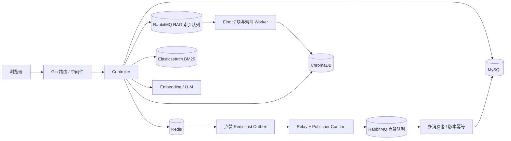

# 货币汇率论坛｜后端开发实习面试复习手册

> 按当前仓库代码和《技术文档-当前实现.md》整理。面试时以你实际负责的工作为准；下面的第一人称答案只在确实做过对应模块时照读。

## 0. 先对齐简历与代码

| 简历说法 | 当前代码事实 | 面试时的准确说法 |
|---|---|---|
| 评论缓存按文章维度维护并主动失效 | 当前评论接口直接读写 MySQL，没有评论缓存 | 删除这条简历描述；若之后实现了缓存，需能展示代码与失效策略 |
| 支持多级回复 | 只支持两层：顶级评论与直接回复；回复不能再回复回复 | 说“父子两层评论结构”，不要说无限层级 |
| Redis 未配置时热榜走 MySQL 聚合 | 这是真的；但 Redis 已配置、运行时不可用时返回暂不可用，避免展示滞后数据 | 补充“仅在明确未配置 Redis 时走同步 MySQL 路径” |
| Redis+MQ 点赞通过 Outbox 保证可靠 | Outbox 是 Redis List，不是 MySQL 事务 Outbox；Lua 原子写状态与事件，Relay 收到 Publisher Confirm 后才删处理项 | 说“Redis List Outbox + 至少一次投递 + 版本幂等”；不要说恰好一次或绝对不丢 |
| Redis 开启 AOF | 生产配置为 AOF `appendfsync everysec` 与 `noeviction` | AOF 降低丢失窗口，但不能承诺故障时零数据丢失；这是 Redis 承载待投递事件的可靠性边界 |
| 汇率查询 | 数据来自系统内置的示例汇率 | 明确说不是实时行情，不能给交易决策背书 |
| 有点赞 Bitmap | Redis Bitmap 的 offset 使用用户 ID | 稀疏或很大的用户 ID 会拉大位图占用；没有容量与压测数据前不要声称可承受某个规模 |
| 高并发/高性能 | 设计减少热点文章行锁，但没有可信 QPS/延迟压测数字 | 讲清楚设计目标、瓶颈和验证方法，不编 QPS |

**简历项目表述建议：**

> **货币汇率论坛｜Go、Gin、GORM、MySQL、Redis、RabbitMQ、Elasticsearch、ChromaDB、Eino**：面向货币交易爱好者的社区论坛，支持用户认证、文章检索、点赞排行、两层评论、示例汇率换算及基于社区文章的 RAG 问答。认证采用 bcrypt 与 JWT Access/Refresh 双令牌轮换，验证码和敏感接口限流由 Redis 支撑。点赞链路使用 Redis Lua 原子维护用户状态、实时计数、ZSet 排行和 Redis List Outbox；Relay 通过 RabbitMQ Publisher Confirm 投递，消费者使用用户-文章唯一索引及 `state_version` 幂等落库，文章点赞汇总批量回写 MySQL。RAG 使用 Eino 递归分块，融合 Chroma 向量召回与 Elasticsearch BM25，并用 RRF 排序；ES 故障回退 MySQL FULLTEXT/LIKE，索引通过 RabbitMQ 异步更新，并按内容哈希、文章版本和索引结构版本避免旧任务覆盖新结果。评论采用 `parent_id` 实现顶级评论与一层回复，顶级评论分页，删除时事务清理回复子树。汇率为系统示例数据，非实时市场报价。

如果需要压缩简历，优先保留“点赞一致性链路”和“RAG 混合检索”，删掉没有在仓库实现的评论缓存描述。

## 1. 速记：面试前至少记住这些事实

- **数据职责：**MySQL 保存用户、文章、评论和点赞关系；Redis 承担缓存、限流、验证码、点赞实时投影、排行榜、Bloom 位图与点赞 Outbox；RabbitMQ 承载点赞持久化和 RAG 索引任务；ES 做 BM25；ChromaDB 存向量。
- **认证配置：**Access 当前配置 120 分钟，Refresh 7 天；前端把两者都保存在 `localStorage`，这是练习项目的安全取舍，不应描述成最佳生产实践。
- **点赞一致性：**请求先经过 Redis Lua；Relay 用 `BRPopLPush` 把事件从待投递 List 原子移到 processing List；RabbitMQ 确认后再 `LREM`；消费者事务幂等 upsert；这是**至少一次投递和最终一致性**。
- **并发乱序：**同一用户对同一文章用唯一索引去重；全局递增 `state_version` 让数据库只接受较新状态。数据库统计字段不是请求链路真值，Redis 实时计数优先，MySQL `likes_count` 批量投影。
- **故障语义：**明确未配置 Redis 时点赞走同步 MySQL 事务、热榜做 MySQL 聚合；Redis 已配置但暂时不可用时点赞与实时热榜返回 503，避免把旧 MySQL 投影说成实时结果。
- **RAG：**Eino Recursive Splitter 默认 child 约 400 字、overlap 80；parent 约 1200 字、overlap 160。向量与 BM25 先融合文章排名，再在候选文章内取相关 child 块、回填 parent 上下文；没有检索依据就不调用 LLM。
- **版本安全：**文章内容哈希识别内容变化，`rag_version` 隔离新旧文章任务，`rag_index_schema_version` 触发索引结构升级。发布/编辑先标 pending，队列失败可由周期同步重新派发。
- **评论：**顶级评论分页，回复随顶级评论预加载；限制两层；删除时事务遍历并软删除该评论的回复子树。当前没有评论缓存。
- **边界：**汇率不是实时；没有压测数字不报 QPS；Redis AOF `everysec` 不等于绝不丢；项目当前 controller 直接访问全局 DB/Redis，`service` 包未接入路由。

**面试前快速定位代码：**

| 话题 | 主要文件 |
|---|---|
| 点赞 Redis 原子状态机、初始化与排行榜 | `back/utils/like_atomic.go`、`back/controllers/like_controller.go` |
| Redis List Outbox、Publisher Confirm、消费者版本幂等 | `back/utils/like_relay.go`、`like_queue.go`、`like_worker.go`、`like_stats_worker.go` |
| 点赞无 Redis 时的 SQL 事务降级 | `back/utils/like_store.go` |
| JWT 生成/轮换/撤销、验证码、令牌桶 | `back/utils/jwt.go`、`captcha.go`、`back/middlewares/rate_limit.go` |
| 两层评论和子树删除 | `back/controllers/comment_controller.go`、`back/models/comment.go` |
| Bloom 位图与文章详情缓存 | `back/utils/bloom.go`、`back/controllers/article_controller.go` |
| Eino 切块、混合检索、引用和索引任务 | `back/utils/rag_document.go`、`rag_hybrid.go`、`rag_answer.go`、`rag_indexer.go`、`rag_index_worker.go` |
| 表结构、索引、软删除字段 | `back/models/` 下各模型 |

## 2. 项目介绍逐字稿

### 30 秒版

> 这是一个面向货币交易爱好者的论坛，后端用 Go、Gin 和 GORM，MySQL 保存业务数据，Redis 负责缓存、限流和点赞实时状态，RabbitMQ 处理点赞持久化与文章异步索引，ES 和 Chroma 分别提供关键词与向量检索。项目里我最重点准备的是点赞的最终一致性链路和基于社区文章的 RAG 混合检索。汇率模块使用的是系统示例数据，不是实时行情。

### 90 秒版

> 这是一个全栈社区项目，用户可以注册登录、发布文章、评论和点赞，也可以查询示例汇率，并向基于社区文章的问答助手提问。后端是 Go、Gin、GORM；MySQL 是关系数据存储，Redis 用于文章详情缓存、令牌桶限流、验证码以及点赞实时投影；RabbitMQ 分别承担点赞异步持久化和 RAG 索引任务；文章关键词搜索使用 Elasticsearch，RAG 向量放在 ChromaDB。
>
> 我重点介绍点赞链路：如果每次点赞都直接锁文章行更新关系和总数，热点文章会让写请求互相等待。因此请求使用 Lua，在 Redis 单次原子操作里校验用户状态、改 Bitmap、更新计数和 ZSet，并把带版本号的事件写入 Redis List Outbox。Relay 把事件移到 processing List 后发布到 RabbitMQ，收到 Publisher Confirm 才删除处理项。消费者允许多实例并行，通过用户和文章唯一索引、`state_version` 做幂等 upsert，最后批量把计数投影回 MySQL。它是至少一次投递、最终一致，不是恰好一次。
>
> RAG 方面，文章经 Eino 递归切块并写入 Chroma；查询时把向量召回和 ES BM25 的文章排名用 RRF 融合，再取具体文本片段和父块上下文交给模型。ES 故障时退回 MySQL FULLTEXT/LIKE，向量检索不可用但关键词有结果时也能用文章片段兜底；无依据时直接拒答。评论目前是两层结构，汇率数据是示例数据。

### 3 分钟深挖版：以“为什么这么设计”串起来

> 项目里我选择展开点赞，是因为它同时涉及并发控制、缓存投影、消息可靠性和幂等。同步方案其实更简单：MySQL 事务锁住文章，检查用户点赞关系后更新关联表和计数。但热门文章会让所有点赞请求竞争同一行，吞吐和尾延迟都受影响，所以 Redis 配置存在时采用 Redis 快路径。
>
> 点赞/取消点赞的状态检查、Bitmap 更新、计数、ZSet 和事件入队放在同一段 Lua 里，避免 Redis 状态已经改变但事件没写进去。Outbox 使用 List 是为了兼容项目需要支持的 Redis 3。Relay 用 `BRPopLPush` 原子地把消息移到 processing；RabbitMQ 对持久消息返回 Publisher Confirm 后，Relay 才清除 processing 里的那条消息。Relay 在 Confirm 后、清理前崩溃会重复投递，所以消费者必须幂等。
>
> 消息消费端的唯一键是 `(user_id, article_id)`，同时带递增状态版本。并发消费者可能乱序处理，因此数据库只接受更大的版本，较老事件成为 no-op。点赞关系异步落 MySQL，`articles.likes_count` 也由后台 worker 批量投影并失效文章详情缓存。前端读点赞状态和热榜时看 Redis 实时结果；这个模式提供最终一致性，不把 MySQL 汇总字段冒充实时数据。
>
> 可靠性边界也需要说清：Redis 的待投递事件依赖 AOF 与不淘汰策略；`appendfsync everysec` 仍有很短的潜在丢失窗口，因此不是零丢失的事务消息系统。Redis 已配置但运行故障时，我选择短暂返回不可用，不切到可能落后的 MySQL；只有 Redis 明确没有配置时才走同步数据库事务。若要更强的持久性，我会把权威状态与 Outbox 放进同一个 MySQL 事务，或采用可证明持久的事件日志，再配合重试、死信和告警。

### 被问“你本人具体负责什么”时

不要把项目所有功能都说成个人独立完成。按真实情况替换下面这句：

> 我个人主要负责【填实际负责模块】。其中我做得最深入的是【具体功能】，代码落在【目录/文件】，我解决的问题是【问题】，采用【方案】，通过【测试/日志/手工复现/评测】验证了【可证实结果】。其他模块是项目已有能力或由队友负责，我可以解释整体设计，但不会把它们算作我的个人产出。

如果确实独立完成，可以明确说“我独立完成了后端主要功能”，同时准备讲出实现过程、遇到的 bug 和取舍。

## 3. 架构图与关键请求路径

**请求链路可以这样讲：**

1. Gin 路由挂载限流、鉴权等中间件；鉴权从 Access JWT 取用户 ID、用户名和 JTI。
2. Controller 校验输入和权限，调用全局 DB/Redis 或 `utils` 里的领域函数。
3. MySQL 保存关系型主数据；Redis 提供实时态与缓存；耗时或可重试工作交给 RabbitMQ worker。
4. 错误按能力返回：验证码、认证存储不可用时认证失败关闭；敏感限流当前 Redis 故障时放行，是需要告警和按接口评估的 fail-open 选择。

**诚实的工程结构回答：**当前 controller 直接依赖 `global.Db`、`global.RedisDB`，领域逻辑在 `utils` 包函数中，`service` 目录没有接入 Router。它便于早期快速实现，但测试替换依赖、业务边界和扩展性一般。重构时会引入构造函数依赖注入、Repository/Service 接口、按领域拆包，并让 Controller 只做 HTTP 输入输出与状态码映射。

## 4. 项目设计深挖题

### 4.1 点赞、Redis 与 RabbitMQ

**Q：完整描述一次点赞请求。**

> 请求通过 JWT 取到用户 ID，并先经过共享令牌桶限流。业务函数确认文章和 Redis 投影可用后，调用 Lua：若当前状态允许转换，就更新用户 Bitmap、计数和排行榜 ZSet，生成递增版本号并把事件写进 Outbox。HTTP 返回的是 Redis 实时计数。后台 Relay 将 Outbox 事件移入 processing，RabbitMQ 确认发布后清理；消费者按事件版本幂等更新 MySQL，统计 worker 再批量同步文章汇总数。

**Q：为什么用 Lua，pipeline 或 MULTI 不够吗？**

> Pipeline 只减少网络往返，不能保证多条命令之间没有其他客户端插入；事务可以排队执行，但这个场景还要根据前面读出的点赞状态决定是否改计数、排行榜和 Outbox。Lua 在 Redis 服务端把读、校验和写作为一个原子脚本完成，避免重复点赞把计数加多，也避免状态与事件只成功一半。脚本要短，避免阻塞 Redis 主线程。

**Q：为什么不用 MySQL 直接做？**

> MySQL 事务更容易提供关系数据的一致性，也有明确的持久性；低流量下我会优先用它。这个项目想避免每个热门文章点赞都锁同一行，所以 Redis 负责请求路径的实时状态，RabbitMQ 把关联状态异步持久化。代价是多了最终一致性、重建和 Redis 持久化问题；这不是所有业务都应该套用的高并发模板。

**Q：为什么它是“至少一次”，怎样避免重复与乱序？**

> Relay 先发布，等 Publisher Confirm 再删除 Outbox 项。如果它在收到 Confirm 后、删除之前崩溃，重启会重投，所以天然会重复。消费者以 `(user_id, article_id)` 唯一键 upsert，并比较 `state_version`，重复版本和较旧版本都不改变最终状态。Broker ack 发生在数据库处理成功后；如果 ack 前进程挂了，RabbitMQ 重投，幂等写入兜住重复。

**Q：Publisher Confirm 是不是说明业务处理成功？**

> 不是。Publisher Confirm 只说明 RabbitMQ 接受了这次发布；它不代表消费者已经处理。消费者处理成功后要单独 ack。这里分别处理生产端投递确认和消费端处理确认。

**Q：Redis List Outbox 的流程和可靠性如何？**

> Lua 把事件写进待处理 List；Relay 用 `BRPopLPush` 原子转移到 processing List。收到 RabbitMQ confirm 才从 processing 删除。Relay 重启时会把 processing 中未清理的项移回待处理 List 再试，因此中途失败不会被当成完成。List 便于兼容 Redis 3，但缺少 Streams 的消费组和消息元数据能力；事件可靠性最终仍依赖 Redis AOF、内存策略和备份。

**Q：Redis 和 RabbitMQ 都故障，用户点赞会怎样？**

> Redis 已配置但无法访问时，点赞返回 503，不会假装成功；因为没有地方原子保存点赞状态和事件。Redis 正常但 RabbitMQ 不可用时，Lua 已把事件放进 Outbox，Relay 后续重试。若 Redis 整体丢失且事件尚未进 RabbitMQ，当前方案不能承诺恢复最后一段数据；AOF `everysec` 只能缩小风险窗口。更强要求应使用 MySQL 事务 Outbox 或外部持久化日志。

**Q：Redis Bitmap 的点赞状态有什么问题？**

> Bitmap 用用户 ID 作为 bit offset，单个用户状态只需一位，读取和状态变更很快；但内存按最大 offset 增长，不是按实际点赞人数增长。用户 ID 大且稀疏时会浪费空间，用户规模增长后要量化每篇文章的位图内存，考虑 Redis Set、压缩 bitmap 或 userId 到紧凑序号的映射，并制定迁移方案。

**Q：为什么排行榜使用 ZSet？**

> 每篇文章 ID 是 member，实时点赞数是 score。Lua 同步修改 score，查询用 `ZREVRANGE ... WITHSCORES` 直接取前 N 名，避免每次从 MySQL 聚合排序。更新和范围查询都适合这个结构。Redis 投影不可用时不能谎称旧数据实时，所以当前配置了 Redis 但故障会暂时返回不可用；明确关闭 Redis 才走 SQL 聚合。

**Q：点赞消费者多实例如何避免热点锁？**

> 请求端不再锁文章行；消费者在事务中先确认文章存在，再依赖 `(user_id, article_id)` 唯一索引做 upsert，只在同一关系冲突时串行化。不同用户、不同文章能并行。`state_version` 负责同一用户-文章事件乱序；MySQL 仍会有索引页、连接池和同一用户热点等上限，要以压测为准。

**Q：MySQL `likes_count` 和 Like 关联表谁是准的？**

> 在 Redis 异步模式下，请求的实时 UI 状态由 Redis 投影给出；Like 表是异步持久化的关系状态，`articles.likes_count` 是便于详情展示/排序的汇总投影，后台批量写入。Redis 未配置时则回到 MySQL 同步事务，关联表和计数同事务更新。数据修复时应从有效 Like 关系重算汇总，而不是把缓存值盲目覆盖回数据库。

**Q：消费者数据库失败、坏消息或积压怎样处理？**

> 临时数据库错误时 nack 并重投，消息处理本身幂等；格式非法的消息记录日志后 ack 丢弃，避免毒消息无限循环。现有实现对临时错误做短等待，但生产级版本我会加有上限的指数退避、重试次数、DLQ、积压/重投告警和手工回放工具。也要给每条消息带可追踪 event ID。

### 4.2 缓存、布隆过滤器和评论

**Q：文章详情缓存是什么模式？**

> 详情查询先读 Redis，miss 后检查 Bloom，再回源 MySQL，最后写回带 TTL 的缓存，这是 Cache Aside。编辑和删除后删除详情缓存；写 DB 成功才失效缓存。缓存不是主数据，Redis 不可用时详情还能回 MySQL。并发读旧值后再回填可能与失效竞争，严谨做法可用文章版本号缓存键、短 TTL、延迟二次删除或一致性事件，并观测缓存命中率。

**Q：布隆过滤器怎么防穿透，是否会漏掉真的文章？**

> Bloom 由多个 hash 映射到固定 Redis Bitmap。若某一位是 0，可以判定这个 ID 不在已构建集合中；所有位是 1 只能说可能存在，所以可能误判无效 ID，之后仍以 MySQL 查证。当前只有过滤器 ready 且位图存在时才允许用负结果直接返回 404；没初始化、键丢失或 Redis 错误时回源数据库，避免过滤器状态导致真实文章被拒绝。过滤器容量固定为 100 万 bit，文章数上升会增加误判概率，需要重建或扩容。

**Q：缓存穿透、击穿、雪崩怎么区分？**

> 穿透是持续查询不存在的数据，可用 Bloom、参数校验和短时空值缓存；击穿是一个热点 key 失效后并发回源，可用 singleflight、互斥重建或逻辑过期；雪崩是大量 key 同时过期或 Redis 故障，可用 TTL 抖动、多级缓存、限流、预热和降级。要区分具体故障再选方案，不能只回答“加 Redis”。

**Q：评论是无限树吗，删除父评论怎么处理？**

> 不是无限树。`parent_id` 为空的是顶级评论；回复只能指向顶级评论，并且必须属于同一文章。顶级评论分页，回复按时间顺序 preload。删除时在事务中找出回复子树并软删除，避免留下不可见孤儿。若产品需要无限层级，应考虑递归 CTE、路径枚举、闭包表或祖先路径，并评估排序、分页和删除成本。当前没有评论缓存。

### 4.3 认证与安全

**Q：bcrypt 和普通 SHA 哈希有什么区别？**

> 密码不是可解密数据，应该只保存单向哈希。bcrypt 专为密码设计，包含随机盐并有可调计算成本，使批量暴力尝试更贵；普通 SHA-256 太快，不适合直接存密码。登录用 bcrypt compare 比较明文和哈希，不自己解密或比较字符串。

**Q：Access/Refresh 双 Token 怎么工作？为什么轮换？**

> Access Token 用于普通接口，短一些；Refresh Token 只用于续期，有更长 TTL。两种 token 用 `typ` 区分，都有签名、过期时间和 JTI。Refresh JTI 保存在 Redis，续期时 Lua 原子消费旧 Refresh、拉黑旧 JTI 并登记新 Refresh，两个并发续期最多一个成功；登出则吊销 Refresh 并把当前 Access JTI 加黑名单。Redis 是吊销状态的依赖，所以不可用时认证相关接口应该失败关闭。

**Q：JWT 是无状态的，为什么还要 Redis？**

> 签名和 exp 校验本身不需要查库，但要即时登出、Refresh 一次性轮换、封禁已泄露 token，就要维护服务端撤销状态。这样换来可撤销性，也重新引入 Redis 可用性依赖。若完全无状态就只能等短 Access 自然过期；要做权限变更即时生效还要额外机制。

**Q：JWT 被盗怎么办，浏览器存哪里？**

> 当前前端把 Access 和 Refresh 都放在 localStorage，XSS 一旦执行就可能读取它们。生产我会把 Access 有效期缩短并尽量放内存，Refresh 用 HttpOnly、Secure、SameSite Cookie，并配 CSRF 防护、CSP、XSS 转义和轮换检测。发现盗用可吊销 Refresh、拉黑 Access，记录异常设备并要求重新登录。当前 Access 配置 120 分钟，仍可讨论缩短；这套实现不能描述成完整生产级身份系统。

**Q：验证码为什么单次使用？**

> 图形验证码存在 Redis 并设 5 分钟 TTL。验证时用 Lua 读取并删除，避免一个正确答案并发复用。验证码是自动化滥用的摩擦，不取代密码强度、限流、异常登录检测或 MFA。Redis 不可用时验证码接口失败关闭。

**Q：令牌桶限流怎样工作？**

> 每个限流 key 保存 token 数和上次时间；请求到来时按经过时间补充令牌，达到容量封顶，再扣一个令牌决定放行或 429。Lua 让读、补充、扣减原子执行。未登录按可信客户端 IP，登录后按用户名限。当前中间件在 Redis 未配置或命令失败时放行，这是 fail-open；对登录爆破或高成本 RAG 这有安全/成本风险，生产要逐接口决定 fail-open/closed，配本地兜底和告警。反代 IP 只有配置可信代理后才能读取 XFF。

### 4.4 RAG、搜索和异步索引

**Q：从文章发布到回答问题经历哪些步骤？**

> 发布或编辑时文章先写 MySQL 并标记待索引，再把文章 ID 和版本发到 RAG 队列；worker 拉取当前文章、构造标题摘要等文档、用 Eino Recursive Splitter 按段落/句子递归分块、调用 Embedding 并 upsert 到 Chroma。问答时分别做向量召回和 ES BM25 召回，用 RRF 融合文章排名，再在候选文章里查具体 child chunk，回填父块上下文、过滤软删除和过期版本，最后带引用上下文调用 LLM。

**Q：RRF 是什么，为什么不用两个分数直接相加？**

> 向量距离、ES BM25 分数尺度不同，直接加权容易让某一类分数天然占优。RRF 只用排名融合，某文章在多个召回列表都靠前就会得到更高分，形式是对每个列表累加 `1/(k + rank)`；本项目 `k=60`。它减少分数归一化问题，但不保证一定提高质量，仍要用标注集评估 Recall@K 和引用准确率。

**Q：为什么向量和关键词混合？**

> 向量更擅长语义相似和改写，BM25 对专有名词、币种代码、数字和精确关键词通常更敏感。混合召回能补两边盲区。当前 ES 故障时回退 MySQL FULLTEXT，若全文索引不可用再走 LIKE；向量服务故障时有关键词命中则可取文章原文片段兜底。

**Q：为什么分块，overlap 与 parent-child 有什么用？**

> 整篇文章过长会让 embedding 检索粒度粗，也会占满模型上下文；按语义边界切块让召回落到相关段落。Overlap 缓和事实刚好被切断的问题。Parent-child 只将小 child 向量化用于精准检索，命中后把对应较大的 parent 作为上下文，兼顾定位和语境。块大小是配置初值，应该用检索评测调，不是普适最优值。

**Q：文章编辑与旧索引任务乱序怎样保证？**

> 内容 hash 判断正文、标题、摘要是否变化；发生变化时递增 `rag_version`。队列消息带版本，worker 取数据库最新文章并丢弃已过期的任务。向量 metadata 记录文章版本和 schema 版本，检索前确认文章未删除且版本匹配。修改分块结构时递增 `rag_index_schema_version`，周期同步会重新索引；新索引成功后再清理旧块。

**Q：索引队列消息失败会怎样？**

> 发布文章仍先在 MySQL 标记 pending，RabbitMQ 发布失败不会把文章标成索引成功；周期同步 worker 定期扫描 pending/failed 或 schema 不一致的文章再派发。消费者遇到处理失败会 ack，避免服务故障时形成 requeue 热循环，由周期任务重试。这个设计换来恢复简单，但恢复延迟受同步周期影响；RAG 发布目前没有点赞 Relay 那种 Publisher Confirm Outbox，不要混为一谈。

**Q：怎么减少 RAG 幻觉和 Prompt Injection？**

> 无检索结果就直接返回“根据现有文章内容无法确定”，不调用 LLM；System Prompt 限定只能依据文章，明确检索内容是不可信用户文本，并要求事实附文章引用。服务端过滤模型引用的文章编号，只允许引用本次提供的来源；问题涉及实时行情时额外提示文章更新时间不是实时价格。它只能降低风险，不能从原理上证明模型绝不出错，所以要做引用核验和拒答评测。

**Q：如何评估 RAG？**

> 准备人工标注的问题、预期可回答文章和应拒答问题；看 Recall@K、引用文章准确率、拒答准确率、延迟 p50/p95 和 token 成本。仓库有 35 条人工评测样本，包含可回答和应拒答问题；我会比较不同 chunk/TopK/融合参数的结果，不只看几条主观演示。没有实测报告时，不宣称效果提升百分比。

## 5. Go / MySQL / Redis / MQ 八股快答

### Go

**Q：goroutine 和线程有什么区别？**

> Goroutine 由 Go runtime 调度，初始栈小且可增长，多个 goroutine 复用较少的 OS 线程，创建和切换通常更轻。但它不是免费的：阻塞 I/O、锁竞争和无界 goroutine 仍会耗尽资源，所以要有并发上限、取消和生命周期管理。

**Q：channel 和 mutex 怎么选？**

> 共享状态需要短临界区保护时用 mutex，通常更简单；用 channel 表达任务传递、流水线和 goroutine 协作。不要为了“Go 风格”把所有锁改成 channel。无论哪种都要确认所有权、关闭方唯一和退出路径。

**Q：Go map 能并发读写吗？**

> 普通 map 并发读读可以，但读写/写写需要同步，否则可能 data race 或直接触发并发 map 错误。可以用 mutex、读写锁、`sync.Map` 或单 goroutine owner。是否选 `sync.Map` 看读写模式和类型安全需求。

**Q：slice 是什么，append 会发生什么？**

> Slice 是指向底层数组的一段描述，包含指针、长度和容量。append 在容量够时复用底层数组，不够时分配新数组并复制；因此两个 slice 共享 backing array 时修改可能互相影响。大 slice 只切小子片也可能让底层大数组无法回收，必要时复制需要的数据。

**Q：context 主要解决什么？**

> 用来跨 API 传递请求取消、deadline 和少量请求级值。HTTP 请求被取消时，DB/下游调用和派生 goroutine 应尽量跟着停止；不能把 Context 放进长期结构体，也不要把业务参数塞进 context values。所有 worker 都应有明确停止信号。

**Q：什么是 goroutine 泄漏？如何避免？**

> Goroutine 因为永远等不到 channel、锁、网络响应或取消信号而无法退出。给阻塞操作设置 deadline，select 监听 `ctx.Done()`，限制队列和并发，确保 channel 生命周期清晰；观察 goroutine 数和 goroutine profile。只启动 goroutine 而没有 owner 负责关闭是常见问题。

**Q：defer、panic、recover 怎么理解？**

> defer 在函数返回时按后进先出执行，常用于 Close、Unlock。panic 用于不可恢复的程序错误，不建议当普通业务错误；recover 只能在 defer 中捕获当前 goroutine 的 panic。HTTP 边界可以 recover 并记日志，不能因此吞掉错误或继续使用不一致状态。

**Q：Go error 怎么包装？**

> 返回 error 给调用方决定处理，增加上下文时用 `%w` 包装，调用方用 `errors.Is/As` 判断错误类别。不要只比较错误字符串，也不要每层重复打印同一个错误导致日志噪声。对外响应返回稳定、适度的错误信息，不泄露 SQL 或密钥。

**Q：interface 的 nil 陷阱是什么？**

> interface 是动态类型和动态值两部分。把类型为 `*T` 的 nil 指针赋给 interface 后，动态类型存在，所以 interface 本身不等于 nil。写返回 interface 的函数、错误接口和依赖注入时要留意这一点；可以避免返回“typed nil”。

**Q：Go GC 简单说？**

> Go 使用并发、三色标记清除为主的垃圾回收，目标是在吞吐和暂停间折中。减少不必要分配、复用大对象要基于 profile，而不是盲目 pool；优先看 `pprof` 的 CPU、heap、allocs、goroutine 和 mutex profile。

### MySQL / InnoDB

**Q：事务 ACID 是什么？**

> 原子性要么全成功要么回滚；一致性是事务前后满足约束；隔离性控制并发事务可见性；持久性在提交后通过日志等机制恢复。ACID 是数据库保障，不代表业务跨 MySQL、Redis、RabbitMQ 自动原子。

**Q：MVCC 和行锁分别解决什么？**

> InnoDB 用 undo 版本链和 Read View 支持一致性读的多版本可见性，减少读写互相阻塞；行锁保护当前写冲突。MVCC 不会消灭所有锁，更新、当前读、唯一索引检查和范围锁仍可能阻塞。

**Q：RR 和 RC 的差别？**

> Read Committed 通常每条一致性读创建新的 Read View；Repeatable Read 在事务中复用快照，普通读能重复看到相同版本。InnoDB RR 的当前读可能使用 next-key lock 防止部分幻读。具体行为要区分普通一致性读与 `FOR UPDATE` 当前读。

**Q：联合索引为什么遵守最左前缀？**

> B+Tree 按联合键从左到右排序。索引 `(a,b,c)` 能有效支持从 a 开始的前缀条件，但只按 c 查通常无法按该树定位。等值列一般放前面，再看范围和排序；仍要用 EXPLAIN、数据分布和真实查询确认是否走索引。

**Q：什么是覆盖索引？**

> 查询要的列都能从二级索引读到，不需要回主键聚簇索引取整行，减少随机 I/O。为了覆盖而塞太多列会让索引膨胀、写入变慢，所以按热点查询设计。

**Q：项目会怎么设计点赞表索引？**

> `likes` 有 `(user_id, article_id)` 唯一索引保证同用户同文章最多一条关系，还有 article_id 索引用于按文章统计。表里保存软删除状态和 `state_version`。唯一键不只为提速，也承担幂等约束。文章列表按创建时间分页，数据量上来后会补 `(created_at,id)` 复合索引并检查软删除条件与执行计划。

**Q：Offset 分页有什么问题？**

> 深分页需要扫描/跳过前面大量记录，数据写入还会导致页间重复或漏项。小规模后台列表可用 Offset；大列表改为基于 `(created_at,id)` 的 keyset/cursor pagination，下一页条件使用上一页末尾的组合键。

**Q：如何排查慢 SQL？**

> 先从慢日志或 tracing 找到 SQL 和参数分布，EXPLAIN 看访问类型、候选索引、估算行数、临时表和 filesort；确认索引顺序、隐式类型转换、返回列和 N+1。优化后用代表性数据验证耗时与写放大，避免只凭“加索引”结论。

**Q：死锁发生了怎么办？**

> 先抓数据库死锁日志和事务语句顺序，找出循环等待资源。统一加锁顺序、缩短事务、减少范围锁、为查询补合适索引；死锁仍可能发生，调用方要能识别并对整个幂等事务有限重试。不要无限重试或在事务里调用慢外部服务。

**Q：GORM 事务和连接池要注意什么？**

> 事务里所有 SQL 都要用传入的 `tx`，不能部分走全局 DB；事务尽量短，不要在持锁期间调用模型服务。连接池的最大连接数应结合 MySQL 上限、实例数和业务并发配置，监控等待时间、活跃连接和慢查询。仓库当前池参数是配置值，不应冒充经过压测调优。

**Q：为什么生产通常不用启动时 AutoMigrate 管理全部变更？**

> AutoMigrate 适合开发环境快速建表，但生产 schema 变更需要可审计、可排序、可回滚和兼容新旧版本；大表 DDL 也可能锁表或影响复制。生产更适合版本化 migration、先扩展后收缩的兼容发布流程。

### Redis

**Q：项目中哪些 Redis 数据结构分别做什么？**

> String 用于文章缓存、计数器、token；Hash 保存令牌桶状态和点赞脏文章版本；Bitmap 记录文章-用户点赞状态及文章 Bloom 位；ZSet 保存按点赞数排序的热榜；List 是待投递和 processing Outbox；Set 记录待 MySQL 落库的文章事件。结构选择基于读写操作，不是为了多用 Redis 类型。

**Q：Redis Lua 的原子性边界是什么？**

> 单个脚本执行期间不会穿插其他 Redis 命令，因此脚本内多 key 状态变化对其他客户端看起来是原子的。它不和 MySQL 或 RabbitMQ 形成分布式事务；脚本也运行在 Redis 主线程，必须控制耗时和遍历规模。

**Q：RDB 和 AOF 的区别？**

> RDB 是某个时点的数据快照，恢复快、文件紧凑，但两次快照之间故障会丢数据；AOF 记录写命令，通常数据丢失窗口更小但文件/重写成本更高。项目生产设 `appendfsync everysec`，所以不能承诺最后一秒完全不丢；还需做备份、恢复演练和监控。

**Q：Redis 作为缓存要不要淘汰？**

> 纯缓存可以按业务选 LRU/LFU 等淘汰策略；点赞 Outbox、未落库事件和实时状态不能被当作普通缓存随意淘汰。生产配置 `noeviction` 保护这些状态，但内存满时写入会失败，所以必须做容量估算、告警和扩容。把关键事件和可淘汰缓存混在一个实例也需要谨慎。

**Q：热点 key 怎么办？**

> 先从 Redis QPS、热 key 统计和延迟确认；可本地短缓存、复制读、分片 key、请求合并或业务拆分。写热点还可以异步批量聚合，但会增加可见延迟。项目点赞在 Redis 单线程原子化避免 MySQL 文章行锁，并不等于 Redis 热文章 key 没有上限。

### RabbitMQ / 消息系统

**Q：RabbitMQ 的 exchange、queue、binding 是什么？**

> Producer 通常发给 exchange，exchange 根据 binding 和 routing key 路由到 queue，consumer 从 queue 消费。项目点赞 relay 使用 default exchange 直接投递到已声明的 durable queue。生产系统还要明确路由不可达、队列类型、死信和重试策略。

**Q：durable queue 和 persistent message 分别保证什么？**

> Durable 让队列元数据在 Broker 重启后保留；persistent 让消息按持久化语义写盘。二者都不等于消息已经被业务处理，也不替代 publisher confirm、consumer ack 和副本容灾。

**Q：autoAck 与手动 Ack 怎么选？**

> autoAck 在收到消息时就确认，消费者崩溃可能丢掉未处理任务；手动 Ack 可以等处理成功后确认，失败时 nack/requeue 或送 DLQ。项目消费端手动 Ack，DB 暂时失败时重投；成功后才 Ack。

**Q：如何限制消费者积压和公平性？**

> 用 QoS prefetch 限制每个 consumer 未确认消息数，并根据单条处理耗时、并发和 DB 连接池调节。项目点赞消费者默认 4 个，每个 channel prefetch 64；这是初始配置，不是最优结论。监控 queue depth、消费速率、处理延迟、未确认数量和重投次数。

**Q：怎么保证严格顺序？**

> 多消费者、重试和网络都会打乱完成顺序，单队列也不代表业务处理完成顺序严格。若某个 key 要顺序，可以按 key 分区到同一队列/消费者或串行消费，并用版本检查兜住；本项目通过状态版本接受最大版本，不要求每条中间状态都严格按序生效。

### HTTP / TCP / 操作系统基础

**Q：TCP 为什么是三次握手？**

> 客户端先发 SYN，服务端确认客户端的序列号并发自己的 SYN，客户端再确认服务端的 SYN。双方由此确认收发能力和初始序列号都可用。两次时服务端无法确认客户端是否收到了自己的 SYN-ACK，也可能把延迟的旧 SYN 当成新连接。

**Q：TCP 四次挥手是什么？TIME_WAIT 为什么存在？**

> TCP 两个方向可以独立关闭，所以一方 FIN、另一方 ACK 后，对方仍可把剩余数据发完，再发 FIN，最后由第一方 ACK。主动关闭方通常进入 TIME_WAIT，等待足够时间让网络中的旧报文过期，并在最后 ACK 丢失时能重发。大量短连接会堆 TIME_WAIT，应优先复用长连接、合理设置连接池和超时，而不是盲目调内核参数。

**Q：TCP 如何保证可靠传输？**

> 通过序列号和确认号检测缺失与乱序，超时/快速重传补发，接收窗口做流量控制，拥塞窗口做网络拥塞控制。TCP 提供有序字节流，不保留应用消息边界；应用层仍需 framing、超时和幂等处理。

**Q：HTTP keep-alive 有什么用？**

> 让多个 HTTP 请求复用同一条 TCP 连接，减少握手与慢启动成本。服务端仍要设空闲超时和连接上限，客户端也要复用连接池；TCP 连接断开、请求超时和业务执行成功之间并不能简单画等号。

**Q：HTTPS 做了什么？**

> TLS 用证书验证服务端身份，协商密钥，再用对称加密保护传输数据并提供完整性校验；非对称密码主要用于密钥协商/身份验证相关过程，对称加密负责高效传输。HTTPS 保护链路，不防止服务器端日志泄密、XSS 窃取 token 或授权逻辑错误。

**Q：HTTP 常见状态码怎么选？**

> 2xx 表示成功；400 是请求参数问题，401 是未认证或凭证无效，403 是已认证但无权，404 是资源不存在，409 可表示状态冲突，429 是限流，5xx 是服务端依赖或内部故障。对外状态码要稳定，具体错误细节写结构化日志而不是把 SQL 错误直接返回。

**Q：GET、POST、PUT、PATCH 的语义是什么？**

> GET 查询且不应改变业务状态；POST 通常创建资源或触发动作；PUT 表示用给定表示替换目标，PATCH 表示局部修改。HTTP 方法语义帮助缓存与重试，但真实幂等性仍要由业务实现。项目点赞是动作接口，重复调用不会重复加计数，但可能返回“已点赞”；需要跨网络重试的复杂操作可增加 Idempotency-Key。

**Q：进程和线程的区别？**

> 进程有独立虚拟地址空间和资源边界，线程共享进程地址空间及大部分资源。线程切换和创建通常比进程轻，但共享内存需要同步；Go goroutine 是 runtime 调度的执行单元，不等同 OS 线程。

**Q：I/O 多路复用解决什么？**

> 一个线程等待多个 socket 的可读/可写事件，避免每条连接都占一个阻塞线程。Linux 常见 select、poll、epoll；Go runtime 在网络 poller 上集成非阻塞网络 I/O，程序仍可以用同步风格调用。CPU 密集和锁竞争不会因为 epoll 自动消失。

**Q：接口收到请求后，客户端断开了，服务端会自动停止吗？**

> 不一定。要把 request context 传给数据库和下游 HTTP 调用，并让耗时任务响应取消；但已经提交的数据库事务或外部副作用未必能撤回。消息消费者等后台工作应使用独立生命周期 context，不能绑定到短暂 HTTP 请求后就意外取消。

## 6. 高频场景题回答

**场景：某篇文章突然有大量点赞，怎么办？**

> 先把写路径拆成状态校验、聚合计数和关系持久化，避免每个请求都锁同一文章行。当前做法是 Redis Lua 快速原子更新并投递事件，RabbitMQ 消费端按用户-文章关系并行幂等落库，汇总数批量刷新。接着压测 Redis 热 key、Bitmap 最大 offset、队列堆积、数据库连接池和消费者吞吐；超过单 Redis 能力时再做分片/分区，而不是先报一个想象的 QPS。

**场景：用户连续点赞、取消、再点赞，RabbitMQ 消息乱序了。**

> 三次状态变化拿到递增版本，例如 v10、v11、v12。即使消费者先写 v12，之后 v10/v11 到达时数据库比较 `state_version` 并忽略旧版本，最终状态仍是 v12。唯一索引保证只有一个 user/article 关系行。要保证版本生成器恢复后严格大于数据库已有最大版本，项目启动/恢复时会用 MySQL 当前最大版本校准 Redis sequence。

**场景：Relay 收到 Confirm 后、删除 Outbox 前挂了。**

> processing 里的事件会在 Relay 重启时重新放回待处理队列，因而会重复发布。不能试图保证不重复；由 event ID、唯一键和版本幂等保证重复无副作用。这正是至少一次投递的典型窗口。

**场景：DB 短暂宕机，RabbitMQ 消息怎么办？**

> 消费者不 Ack，nack/requeue，关系 upsert 保证重投安全；同时监控队列积压并限制重试频率，避免恢复时打爆数据库。更成熟做法是延迟重试队列、指数退避、最大次数和 DLQ。数据库恢复后逐步扩容消费者并观察连接池与慢查询。

**场景：Redis 已经写成功，但消息长期进不了 RabbitMQ。**

> Outbox 事件会留在 List 或 processing List，Relay 轮询恢复连接后继续发；接口的点赞状态已进入 Redis，但 MySQL 关系暂时落后，系统必须标记最终一致并暴露队列积压。需要告警、恢复测试和 Redis AOF 保障；如果 Redis 丢失就无法仅凭 RabbitMQ 找回尚未发布的事件。

**场景：Redis 整体不可用。**

> 区分“没有配置”和“配置了但故障”。前者点赞走 MySQL 同步事务，热榜 SQL 聚合；后者不切到可能陈旧的 MySQL，而是点赞/实时榜返回 503，避免用户看到假成功或错误排名。详情缓存 miss 后可以读 MySQL；验证码和 JWT 撤销依赖 Redis 的功能应失败关闭；限流当前 fail-open，需要报警并评估本地兜底。

**场景：Bloom 说文章不存在，但文章其实存在。**

> 如果过滤器完整构建后发生这种事，属于设计或写入更新 bug，因为 Bloom 理论上没有 false negative；检查构建游标、文章创建时是否同步加位、键被逐出、并发切换和 hash 算法版本。当前 ready/位图缺失时会放行回源 MySQL，文章创建成功后也加位。版本化双缓冲重建能避免构建过程中暴露半成品。

**场景：缓存击穿或删除后马上被旧请求回填。**

> 用 singleflight/互斥重建合并并发回源，热点数据可以预热或逻辑过期；解决旧值回填需要缓存版本号或读后校验版本，必要时用延迟二次删除。当前详情接口有 TTL 与失效，但 DB 更新和 Redis 删除不是一个原子事务，不能声称完全没有竞态。

**场景：文章编辑期间旧 RAG 任务刚好开始跑。**

> 编辑事务递增 `rag_version` 并标 pending；旧任务处理时发现消息版本和 DB 当前版本不同就退出。写向量时 metadata 带文章版本和 schema 版本，查询阶段还会过滤不匹配的块。新索引成功再删旧版本，避免先删旧数据导致新索引失败时完全不可检索。

**场景：Chroma 或 Embedding 挂了，用户还能问答吗？**

> 如果关键词检索可用且有结果，可以回退到命中文章的有限原文片段作为上下文；ES 不可用时关键词检索退 MySQL FULLTEXT/LIKE。两路检索都不可用时返回服务错误，无任何命中时拒绝生成；LLM 本身不可用则返回错误。不要拿旧向量或模型先验假装实时回答。

**场景：RAG 引用了不存在的文章号或回答实时汇率。**

> 服务端仅保留本次检索上下文内的引用 ID，并在 prompt 里把文章当作不可信输入、要求逐条引用。实时性问题会追加限制提示，项目汇率本来就是示例数据。再通过拒答集、引用准确率和人工抽查评估；不能只靠 prompt 宣称不会幻觉。

**场景：如何把当前单体做成可扩展后端？**

> 先把 handler 中的业务编排移到可注入的 Service，数据访问包成 Repository，Redis/MQ/向量库定义接口；把全局连接替换为启动时构造并传入的依赖。然后补契约/集成测试、配置校验、版本迁移和可观测性，再考虑按领域拆进程。拆微服务不是第一步，先明确边界和故障语义。

## 7. 继续追问时可以主动承认的局限与改进

1. **Redis Outbox 持久性：**`appendfsync everysec` 可能丢失最近一秒写入。若业务要求严格恢复，把权威状态变更与 Outbox 放同一 MySQL 事务，再由 relay 发布；或者用更强的持久化日志。即使如此也仍需幂等消费。
2. **Redis 点赞数据结构：**Bitmap 按最大用户 ID 分配空间；要用真实用户规模、ID 分布和每篇文章点赞热度测内存，再选 Set 或更紧凑编码。
3. **RAG 队列与补偿：**当前周期同步约每 300 秒扫 pending，恢复时延可能较长；增加任务状态/重试次数、Publisher Confirm、延迟重试/DLQ、人工重放和指标。
4. **服务分层：**Controller 使用全局单例，`service` 目录未接入；通过依赖注入、Repository 与模块接口提高可测性。
5. **评论模块：**没有缓存，且只支持两层；要上缓存需设计分页粒度、写后失效、热门文章读放大与并发旧值回填。
6. **安全与限流：**Access Token TTL 当前配置 120 分钟；生产可缩短有效期、用更安全的 Cookie 策略、按端点制定 Redis 故障策略，并增加登录异常检测和 MFA。
7. **数据库与部署：**AutoMigrate 适合开发启动，生产应用版本化 migration；连接池、索引、消费者数与 RAG 参数需要压测和监控支持。
8. **可观测性：**结构化日志之外，还应有 request ID / trace ID、点赞事件从写入到落库的延迟、Outbox 长度、MQ 队列深度、Redis 命中与错误率、DB 连接等待、RAG 各阶段延迟和 token 成本。

回答改进点时不要只批评项目，要给“风险—影响—改进—验证方式”。例如：“Bitmap 的内存跟最大用户 ID 相关，我会先按生产 ID 分布估算并压测，再和 Set 比较单成员空间、读写延迟与重建成本。”

## 8. 自我介绍、项目动机与反问

**Q：为什么选 Go 做后端？**

> 我希望做并发和网络服务方向，Go 的 goroutine、context、标准库和部署方式比较适合写 API 与后台 worker。项目中 HTTP handler、RabbitMQ consumer 和 Redis 交互能让我把并发、取消、幂等与数据一致性一起练到，而不只是写 CRUD。

**Q：项目里最难的是什么？**

> 我会选【真实负责的模块】。难点不是“接入 Redis/MQ”，而是明确故障窗口。例如点赞在 Redis 状态变更后、RabbitMQ 发布前崩溃怎么办；我通过原子写 Redis List Outbox、Confirm 后清理、消费者版本幂等来缩小丢失风险。之后我也会说明 AOF `everysec` 仍有风险，避免把方案说成绝对可靠。

**Q：如果时间允许最先改什么？**

> 我会先处理【按岗位选择】。如果偏业务可靠性，会让点赞权威状态和 Outbox 落同一 MySQL 事务；如果偏工程质量，会把 controller 的全局依赖改为注入 Service/Repository；如果偏性能，会补压测和指标后再优化连接池、索引或 Redis 热 key。先量化基线，再做变更。

**Q：汇率是不是实时的？**

> 不是。它是项目数据库里的示例汇率，用来演示查询和交叉换算。要做真实报价需要可信行情供应商、更新时间与来源、超时/缓存策略、异常和过期状态展示，不能把历史或示例值说成当前市场价。

**Q：你怎样证明方案有效？**

> 对业务正确性看并发重复点赞、取消后重赞、重复消息、乱序版本、Relay 中断和 Redis 局部键丢失等测试；对性能做固定数据规模与并发模型的压测，报告吞吐、错误率和 p50/p95/p99；对 RAG 用标注集评测 Recall、引用和拒答。当前没有明确压测报告时我会只陈述已有的功能验证，不编数字。

**可反问面试官：**

- 实习生通常会负责哪类服务或业务链路？代码评审和导师反馈是怎样安排的？
- 团队后端主要使用哪些存储、消息系统和观测工具？
- 这个岗位前三个月希望实习生交付什么？如何定义做得好？
- 团队在一致性、可用性和交付速度之间通常怎么做取舍？

## 9. 复习顺序

### 面试前 30 分钟

1. 记熟第 0、1 节的事实边界，尤其是评论无缓存、评论两层、非实时汇率、至少一次投递和 AOF 风险。
2. 用自己的话讲 90 秒版项目介绍，不要逐字背得像念稿。
3. 在白纸上画点赞链路：HTTP → Lua → Redis Outbox → Relay/Confirm → MQ → 幂等消费者 → MySQL 投影。
4. 练会三个场景：MQ 故障、消息重复乱序、Redis 宕机。

### 面试前一天

1. Go：slice/map 并发、channel/mutex、context、goroutine 泄漏、error/interface nil。
2. MySQL：事务与 MVCC、索引和 EXPLAIN、锁与死锁、唯一键幂等、深分页。
3. Redis：Lua 原子性、Bloom 假阳性、缓存三类问题、RDB/AOF、数据结构取舍。
4. MQ：confirm/ack、重试、DLQ、幂等、顺序和至少一次。
5. RAG：切块、Embedding、向量/BM25、RRF、版本、防幻觉与评测。
6. 为每个主要技术点准备一条自己遇到的 bug 或验证证据。

### 回答结构

项目问题可以按：**背景/痛点 → 方案 → 一致性或故障语义 → 代价 → 验证/下一步**。

八股题可以按：**定义 → 原理 → 适用场景 → 常见坑 → 项目里的例子**。

场景题先问清流量、延迟、数据丢失容忍度和一致性要求，再给方案；不要上来就堆 Redis、Kafka、分库分表。
